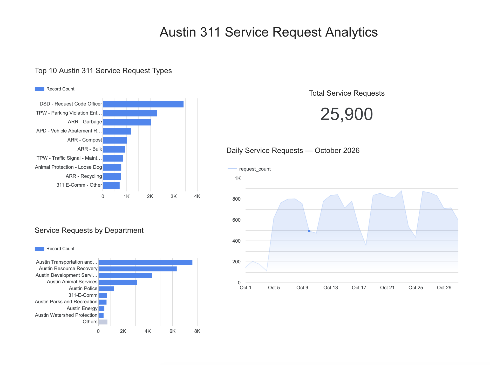

# Austin 311 Data Engineering & Analytics Pipeline

An end-to-end data engineering and analytics project using real Austin 311 service request data. This project demonstrates Python-based data ingestion, Google Cloud Storage, BigQuery transformations, data quality validation, and interactive reporting with Looker Studio.

## Project Overview

The goal is to build a reliable data pipeline that ingests Austin 311 service request data, stores raw source files, transforms and validates records in BigQuery, and presents useful insights through an interactive analytics dashboard.

## Architecture

Python → Google Cloud Storage → BigQuery → Looker Studio

## Technologies

- **Python** — Data ingestion, file processing, and validation
- **Google Cloud Storage** — Raw CSV file storage
- **Google BigQuery** — Cloud data warehouse, SQL transformations, and analytics
- **Looker Studio** — Interactive data visualization and reporting
- **Git / GitHub** — Source control and project documentation

## Work Completed

### 1. Data Ingestion and Processing
- Developed Python scripts to support initial and incremental data ingestion.
- Processed Austin 311 service request CSV files.
- Created batch validation procedures to compare incoming datasets.
- Examined duplicate records across incremental batches.

### 2. Cloud Storage
- Created a Google Cloud project and Cloud Storage bucket.
- Configured a raw incremental storage location.
- Uploaded and verified source CSV files.
- Preserved raw files for auditing and traceability.

### 3. BigQuery Data Warehouse
- Created the `austin_311` dataset.
- Loaded source records into `service_requests_raw`.
- Created `service_requests_clean` using SQL transformations.
- Applied `ROW_NUMBER()` with `PARTITION BY sr_number` and ordering by `sr_updated_date` to retain the latest record for each service request.

### 4. Data Validation and Quality
Validated two incremental batches:

| Validation | Result |
|---|---:|
| First batch records | 25,900 |
| Second batch records | 1,866 |
| Combined raw records | 27,766 |
| Unique service requests | 25,900 |
| Duplicate IDs across batches | 1,866 |
| Duplicate records with differences | 0 |

Additional data quality checks confirmed:
- No missing service request IDs in the clean dataset.
- No missing creation dates.
- No missing statuses.
- Clean record count matched the distinct service request ID count.

### 5. SQL Analytics
Created BigQuery summary tables for reporting:
- `monthly_request_summary` — Monthly service request volume.
- `daily_request_summary_october_2026` — Daily service request volume for October 2026.

Analyzed request trends and used a focused October daily view to make the time-series visualization more meaningful.

### 6. Looker Studio Dashboard

Created an interactive dashboard titled **Austin 311 Service Request Analytics**, including:
- Total service requests.
- Top 10 service request types.
- Service requests by department.
- Daily service requests for October 2026.

## Current Data Results

- **27,766** raw records loaded.
- **25,900** unique service requests in the clean dataset.
- **0** differences found among the 1,866 repeated records across the two batches.
- Data quality checks completed successfully.

## Repository Contents

- `ingest.py` — Initial Austin 311 data ingestion script.
- `incremental_ingest.py` — Incremental ingestion script for retrieving new and updated records.
- `profile_data.py` — Source data profiling and inspection.
- `validate_batches.py` — Batch comparison and validation, including duplicate and overlap checks.
- `daily_pipeline.py` — Automated daily pipeline orchestration, including API ingestion, GCS uploads, BigQuery loading, and SQL execution.
- `Dockerfile` — Defines the container image used to run the pipeline in Cloud Run.
- `requirements.txt` — Python dependencies.
- `sql/refresh_clean.sql` — Deduplicates raw records and retains the latest version of each service request.
- `sql/refresh_monthly.sql` — Rebuilds monthly service request summary data.
- `sql/refresh_daily_october.sql` — Rebuilds daily service request counts for October 2026.
- `data/` — Local source data files (excluded from this public repository).

## Pipeline Architecture

The project uses Google Cloud services to automate the ingestion, storage, transformation, and reporting of Austin 311 service request data.

**Pipeline flow:**

Austin 311 API → Cloud Run Job (Python) → Google Cloud Storage → BigQuery → Looker Studio → Google Sites

### Cloud Components

- **Cloud Scheduler:** Configured to trigger the pipeline daily at 6:00 AM Central Time.
- **Cloud Run Jobs:** Executes the containerized Python pipeline.
- **Google Cloud Storage:** Stores timestamped incremental CSV files, SQL transformation files, and the pipeline watermark.
- **BigQuery:** Stores raw and cleaned service request data and analytical summary tables.
- **Looker Studio:** Provides interactive reporting and visualization.
- **Google Sites:** Hosts the client-facing dashboard website.

### Data Processing

1. Retrieve the last successful run timestamp from Cloud Storage.
2. Request new and updated service records from the Austin 311 API, using a 48-hour overlap to capture updates.
3. Write timestamped CSV files and upload them to Cloud Storage.
4. Append incoming records to the BigQuery raw table.
5. Execute SQL transformations in BigQuery:
   - Deduplicate records by service request number, retaining the latest version.
   - Rebuild monthly request summaries.
   - Rebuild daily October 2026 request summaries.
6. Update the pipeline watermark after successful processing.

Python handles pipeline orchestration, while SQL performs the data transformations in BigQuery.

## Project Status

**Completed:**
- Initial and incremental API ingestion.
- Source data profiling and batch validation.
- Google Cloud Storage integration.
- BigQuery raw and clean table creation and validation.
- SQL-based data transformations and summary table generation.
- Containerized Python pipeline deployed as a Cloud Run Job.
- Cloud Scheduler configured for daily execution at 6:00 AM Central Time.
- Manual end-to-end Cloud Run execution successfully tested.
- Looker Studio analytics dashboard created and refreshed.
- Dashboard embedded in a Google Sites client-facing website.

**Pending verification and future improvements:**
- Verify the first scheduled Cloud Scheduler execution.
- Improve raw-table idempotency for safer retries.
- Make the October-specific daily summary dynamic.
- Add pipeline monitoring and failure notifications.
